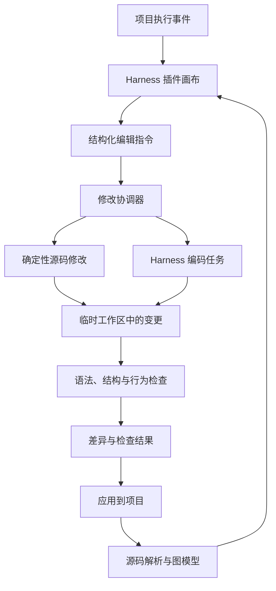

# dsh-langgraph-canvas：项目主设计文档

> 状态：聚焦 LangGraph 结构，插件 v0.8.0；已实现子图按钮导航和返回恢复。本批按用户授权，在 Harness 当前会话打开架构页且缺少本版本 AI 结果时自动补充一次只读解析；缓存／后台任务复用，失败或取消后手动重试，源码修改仍单独确认。见 AUTO-ANALYSIS-001；真实账号解释质量与 Electron 桌面仍待反馈。版本：0.34。更新日期：2026-10-28。
> 暂定名称：dsh-langgraph-canvas。
> 本文件是后续讨论、设计改进、任务拆分、实现与验收的主要依据。

## 1. 文档维护规则

- 需求、范围、架构或验收标准发生变化时，先更新本文件，再实施依赖该变更的工作。
- 实现中的细节调整可与本文件同步提交；不必把每个内部函数写入本文件。
- 区分“已确认需求”“建议方案”“待验证假设”和“已实现能力”，不得把设计当作实现结果。
- 每个阶段完成后记录验证证据、已知限制及剩余工作，更新第 14 节。
- 重要决策记录在第 15 节；后续详细设计可以拆分到其他文件，但应从本文件链接。
- 若代码与本文件不一致，应明确解释原因并修正；未经验证不得静默扩大支持范围。

## 2. 目标与用户

### 2.1 已确认目标

构建一个面向 DeepSeek Harness 的插件，通过可视化操作和自然语言，帮助用户理解、创建和修改其项目中的 Python LangGraph 多智能体架构，并把修改落实到真实源码。

修改对象是用户的 LangGraph 项目，不是 DeepSeek Harness 自身的底层实现。

核心目标：

1. 加速多智能体架构开发。
2. 让图结构、节点职责、状态传递与源码的对应关系更清晰。
3. 降低初学者入门门槛，同时允许用户持续手写和维护代码。
4. 让画布编辑与源码编辑能够在明确支持范围内双向同步。
5. 生成的项目能够通过正常 Python/LangGraph 方式运行，不要求插件持续在线。

### 2.2 原生界面要求（2026-10-23 已确认）

- 架构视图放在现有 Harness 界面内；优先使用“对话／轨迹”旁的原生视图页签，不再使用全屏浮层。
- 空白会话不显示上述页签时，提供会话顶部“◇ 架构”入口，切换现有主区域。
- 直接共用当前 Harness 工作区的项目目录；嵌入模式不提供另一套目录输入，也不恢复独立预览页的历史目录。切换工作区后重新读取，并清除旧图与节点选择。
- 配色、字体与浅色／深色模式跟随 Harness 当前主题。
- 本轮只调整入口、目录衔接和主题，不增加源码写回、执行追踪或能力扩展功能。

### 2.3 LangGraph 结构视图范围（2026-10-23 已确认）

当前只展示 LangGraph：共享 State、节点、边、START/END 与静态解析诊断。项目完整目录树、一般模块依赖和项目全结构图延后；扫描文件仅为恢复 LangGraph 图及定位源码服务。

State 放入图内左上角，默认仅显示浮动入口，点击后选择变量含义、读写关系或源码定义；标明为图级数据定义，展示可识别字段和原始类型注解；不伪装成执行节点或运行时数值。节点展示注册 ID、函数引用与职责，边标明流转类型和路由条件，点击节点或边均可查看相关源码。

默认直接显示一个 LangGraph；仅当识别出多个图时提供选择，不推断哪一个必然是主图。父图／子图关系未被当前协议恢复时，不宣称支持子图自动嵌套。MCP/RAG/Tools/Skills 保留接口和目录，暂时从结构视图隐藏未接入入口。

### 2.4 项目图识别与 AI 提取（2026-10-26 已确认）

采用“静态索引＋AI 按需跨文件读取＋确定性证据校验”。静态读取不执行项目或调用模型；Harness 架构页核对完成后，缺少当前版本 AI 结果时按用户要求自动补充一次，有缓存则复用。不要求文件名或注释显式标注 LangGraph。

默认只展示业务目录内识别的图，docs/doc/examples/example/tests/test/archive 下的图归参考，需明确勾选显示；判断按相对根目录的目录名进行，可把 examples/research-team 本身作为工作区直接打开。该分类是目录启发式，尚无用户覆盖配置。工作区、扫描数量、图来源可在收起的来源入口查看；不完整诊断仍可访问，不把示例当作业务图成功。

静态层支持项目内导入／多级转发导入、try 中的 LangGraph 导入、模块别名、字符串常量、字面量节点注册表的有限循环展开、跨文件函数与继承 State；仍不能恢复任意 Python 动态程序。注册表循环图可读，确定性写回器暂不修改它；辅助函数接收 builder 时明确提示部分结构，供 AI 深度解析补充。

用户已授权缺少当前版本结果时自动提交当前 Harness 会话，小“✦ AI”按钮保留手动重试／取消；沿用该会话上下文与所选模型，任务与回复进入原对话；最多 6 轮，以已索引业务 Python 文件为范围，模型可请求具体文件行区间。节点注册、边与 State 必须引用已实际读取且版本一致的区间；拒绝越界路径、未读证据、变化的源码版本与格式错误。位置校验不证明图语义正确，所有 AI 图标注推断且只读。模型无文件／终端／执行工具；后端代读源码，不执行项目。

AI-JSON-001：模型正常完成但 JSON 格式无效时，在原会话内至多追加一次格式纠正，计入上述六轮和五分钟预算，界面显示纠正进度。严格解析完整 JSON 或完整 JSON 代码围栏；不猜补括号、截取片段或执行文本。纠正只引用原会话历史，不重新扫描或绕过读取授权；结果仍经过全部结构、证据与版本校验。再次格式错误／无剩余轮次明确失败，保留静态图与已保存解读。中断、工具调用或非正常结束不触发格式纠正。

AI-EVIDENCE-001：区分当前会话历史与本次任务证据。每轮携带本次唯一解析编号、源码版本和实际读取清单；历史任务／静态索引里的行号不计作本次已读。最终回复若引用索引内尚未读取的有效区间，按原六轮／五分钟／读取预算补读缺口，每批至多六段，再要求当前模型重新核对并返回解读；补读前的回复不直接采用。路径／行号无效立即拒绝。同文件同版本的相邻或重叠已读区间可以共同覆盖一条引用，含缺口或旧版本不能覆盖。取消、源文件变化及预算耗尽均停止，错误明确具体引用，不笼统指称编造。

同版本推断缓存位于项目 .vislang/analysis-cache/latest.json；普通刷新／重开可复用，不自动重调模型，源码版本变化后停用。完整静态图优先于同 ID 的 AI 图；AI 可补充新图或替换静态部分图，不自动推断父子嵌套。AI 解析与源码生成是两条独立流程，缓存不会授权源码写入。预算、任务与边界见 [深度解析 API](docs/api/DEEP_ANALYSIS_API.md)。

### 2.5 面向初学者的架构解读

RAW-NAMES-001（2026-10-27，用户澄清）：界面名称继续为标准模式／专业模式。专业模式节点主标题必须优先使用源码 functionRef 原始引用，不能用注册 ID 或 AI 别名代替；没有已解析的函数／注册对象引用时才回退注册 ID。相同引用被注册为多个节点时附注册 ID 区分。专业画布和函数表不展示 AI 润色名作为节点名称；边、State 读写关系与节点详情标题使用同一原始名称。标准模式保持中文功能名及通俗职责。仅改显示，不重命名源码或重调 AI，保留原模式偏好与编辑确认流程。

VIEW-MODE-001（2026-10-27）：新增“显示模式”选项，名称固定为标准模式／专业模式。默认标准，以中文功能名和易读职责说明为主；专业模式主显源码原始函数／注册对象引用，补充注册 ID 与源码位置；节点命名不采用 AI 别名。边端点、State 读写关系及函数表跟随模式统一显示。切换仅影响展示，保留当前图、选择与未保存布局，不改变编辑／审阅／应用权限，不触发 AI 或重扫源码。选择保存在本机当前宿主来源的 localStorage，重建架构视图时恢复；存储不可用时仍可在当前页面切换，非法值回退标准模式。

AI-NAMES-001（2026-10-27）：节点主标题优先展示 AI 根据实际实现命名的简短中文功能名，如“检索资料”“检查回答”。建立按图与注册节点 ID 对齐的函数模块对照表，包含中文名、原函数、职责及源码位置，默认收起以保留画布空间。名字由当前会话现有 AI 解读自动生成，无额外命名请求；触发方式按 AUTO-ANALYSIS-001：缺少本版本结果时自动补充，有缓存直接复用，小 AI 按钮保留手动重试。原函数引用／节点 ID 保留在详情与表中，中文显示名不改 Python 标识符、图拓扑或编辑事务。旧解读没有名称时显示“功能步骤 N／待 AI 命名”，不根据函数英文名硬猜职责；同图重名用序号区分。名称证据及源码版本沿用解读校验，源码变化后停用。

已实现 AI-EXPLAIN-001：通过现有明确确认的模型通道增加独立架构解读，解释多张图的联系、业务输入与输出、START/END 边界、State 各字段用途、节点实际注册对象及条件判断。完整静态图不因补充文字而被替换；每条解释引用已读取源码，覆盖数量和未知项可见。函数内部调用多个辅助函数仍标为函数节点，内部调用另外展开；可调用对象／链、直接子图与未知类型分别标注。图关系区分直接注册子图、函数内部调用、共用状态定义与待确认关系，提供调用链证据，不把内部调用画成执行边。

解读通过 architecture 附加到 ProjectAnalysis，按图／节点／字段／条件边 ID 对齐，源码版本改变后停用；不改变源码或现有草稿／事务权限。证据位置检查不证明解释正确，界面注明 AI 解读。删除“看懂这套流程”大面板；入口／出口说明附在 START／END，State 按需展开，节点与条件边保留完整详情。只读解读按用户新授权自动补充当前版本，源码生成／应用仍单独确认；已有解析缓存缺少解读时可手动重新分析。字段／分支可以部分解读，但必须展示准确覆盖数量；不预置 IntentNavi 业务说明，不用人工硬编码冒充模型生成。接口见 [深度解析与解读](docs/api/DEEP_ANALYSIS_API.md)。

节点概念以 [LangGraph Graph API](https://docs.langchain.com/oss/python/langgraph/graph-api) 与 [子图机制](https://docs.langchain.com/oss/python/langgraph/use-subgraphs) 为依据：注册函数和函数内部调用其他图，是不同层次的事实；不能根据辅助函数数量改称“函数组”。

### 2.5.1 流程图形状（FLOWCHART-001，已实现，待桌面验收）

将统一卡片画布改为从上到下的流程图：START／END 为圆角终止符、执行节点为矩形、条件路由显示独立菱形、图调用步骤使用双竖线框。判断菱形是已有条件边的展示投影，按来源节点、路由及注册位置分组；保留所有原始边、实际条件、源码区间及编辑入口，不把普通并行／等待汇合误画为条件选择。

直接注册子图与函数内部调用其他图分别标注，仅采用同源码版本且已有证据的关系；不凭名称推断，不改变注册对象类型。目标已知时可点击进入相应图。旧手工布局保留，点击自动排布使用新流程布局；虚拟菱形不进入结构草稿、布局持久协议或源码事务。无新增 AI 自动调用与依赖，Harness 适配及 Electron 桌面验收由乙方继续负责。

### 2.5.2 画布内展开图调用（INLINE-SUBGRAPH-001，历史方案，已被 2.5.3 取代）

点击双竖线框直接在当前画布展开：调用节点成为大容器，内部为目标图的节点、边、条件与边界，默认横向排列以减少容器高度。外层仍连接原调用节点，直接子图与函数内部调用标签保留，容器不宣称内部图包含该函数的全部前后处理。多处调用同图使用独立实例，不合并 State 或节点。子图详情绑定实际所属图，展开视图只读，需编辑时单独打开目标图。

展开采用临时自动排布以让出空间，暂停拖动和布局保存，收起恢复原有位置与未保存状态；展开状态仅保留当前画布生命周期。支持手动嵌套展开，循环关系不无限递归，最多 3 层／500 个展示节点，超限保留单独打开入口。关系仅采用当前源码版本已核对结果，无新增模型请求、源码写入和后端协议变更。

### 2.5.3 子图按钮导航（SUBGRAPH-NAV-001，主功能已实现，待桌面验收，取代 2.5.2）

用户取消同画布大容器。调用节点本体只查看职责，独立“展开子图”按钮才跳转目标图。目标页按实际调用浏览路径显示返回，不把已识别的多个图强行合并或推定共同父图。多目标按钮分别指向相应图；未确认目标保持不可用提示。

当前页面内按工作区／源码版本记录导航历史及每图临时视图，返回恢复真实节点位置、未保存标记、缩放／平移及可用选中项。导航不自动保存、不写源码、不调用模型；源码版本或项目变化后停用旧快照。手动下拉切图重置返回路径。删除内嵌投影及其专用只读详情／深度限制，保留条件菱形、图调用双线框、State 与标准／专业模式。

实际 E 盘类型检查、154 项回归、生产构建与 11 项插件预检通过；本地双图页面验证按钮跳转、返回与位置／视角／选中项／dirty 恢复。截图接口不可用，Electron 桌面验收待乙方补充。见 [SUBGRAPH-NAV-001](docs/handoffs/main/SUBGRAPH-NAV-001.md)。

### 2.5.4 自动补充 AI 解析（AUTO-ANALYSIS-001）

用户要求无需点击即可解析，取代前批手动启动约定。仅 Harness 嵌入页、真实当前会话、源码已核对且后台状态同步完成时启用；缺少同版本有效结果时等待约 1.2 秒提交一次，有结果直接复用。按 API／项目／会话／版本记录已尝试状态；切图、轨迹返回与模式切换不重复提交。后台有任务时只观察，另一会话占用、回执未核对或同步失败时不提交；失败／取消不反复自动重试。新源码版本无错误和阻塞时可补充，小 AI 按钮保留重试／取消。只读解析可能消耗当前会话模型额度，源码修改确认流程不变。无协议、依赖或适配层变动。

本批实际 E 盘类型检查、162 项回归、生产构建与 11 项插件预检通过；本地真实前后端配合确定性提供方验证无需点击启动、轨迹返回不重复与源码版本更新补充。真实账号效果和 Electron 桌面复测待补，见 [AUTO-ANALYSIS-001](docs/handoffs/main/AUTO-ANALYSIS-001.md)。

### 2.6 首批用户

- 正在学习 LangGraph、希望看懂架构和源码关系的初学者。
- 已有 Python 项目，希望加入多智能体能力的开发者。
- 希望通过画布进行架构调整，同时保留源码自由度的个人开发者。

第一版优先服务“有意学习或维护代码的初学者”，不以完全不接触代码的通用应用搭建平台为目标。

## 3. 竞品事实与定位

2026-10-22 的公开资料调查表明：

- Dify 提供可视化工作流、模型与工具编排、代码节点、调试和发布能力，与降低 AI 应用开发门槛的目标重叠。
- 未找到 Dify 原生导入、双向编辑任意 LangGraph 源码工程的证据。此结论不代表所有第三方扩展均不支持。
- LangGraph Sync 已声明支持画布与 Python 源码双向编辑，是更直接的参考项目和竞品。
- 上述能力基于公开说明，尚未在本项目中安装实测，不作为兼容性或成熟度保证。

产品定位：**打开真实 LangGraph 项目，通过画布理解和修改多智能体架构，由 Harness 辅助完成行为实现，交付可继续手写、独立运行的代码。**

需要验证的差异点：跨文件修改、节点行为生成、状态与路由协同修改、对初学者的解释、修改后的实际验证。

参考：

- [Dify Workflow Studio](https://www.dify.ai/workflows)
- [Dify DSL 导出实现](https://github.com/langgenius/dify/blob/main/api/services/app_dsl_service.py)
- [LangGraph Sync](https://github.com/kammeows/langgraph-sync)
- [LangGraph Visualizer](https://marketplace.visualstudio.com/items?itemName=hfloveyy.langgraphv)
- [DeepSeek Harness 仓库](https://github.com/deepseek-ai/deepseek-harness)
- [DeepSeek Harness 架构文档](https://deepseek-harness.github.io/deepseek-harness/en/reference/)

## 4. 核心用户流程

1. 在 Harness 中打开项目，选择或发现 LangGraph 入口。
2. 插件解析项目，展示节点、边、状态定义和诊断。
3. 用户点击节点查看职责、相关源码及可识别的输入输出。
4. 用户调整连线、插入节点或填写行为要求。
5. 插件产生结构化修改指令，判断使用确定性修改还是 Harness 编码任务。
6. 在临时工作区生成代码变更，完成适用检查。
7. 展示代码差异、检查结果和未验证内容，应用变更。
8. 从最终源码重新生成图，刷新画布。
9. 用户运行示例，查看实际执行路径、状态变化和错误。

典型任务：在“研究 → 写作”之间插入“事实核查”，要求失败返回研究，最多重试两次。系统需要协同修改节点实现、共享状态、条件路由与计数逻辑。

## 5. 第一版范围

### 5.1 包含

- 本地、单用户、Python LangGraph 项目。
- 每次编辑一个选定的图入口。
- 常见显式节点注册、普通边、明确的条件路径映射。
- 跨文件节点函数定位；在明确上下文中由 Harness 修改相关文件。
- 源码定位、文件监听、布局保存。
- 增删普通边、编辑支持的条件映射、辅助插入新节点。
- 代码差异、基础验证、冲突检测和撤销。
- 最小运行路径与节点结果展示。

### 5.2 暂缓

- 任意 Python/LangGraph 写法的无损双向编辑。
- 复杂嵌套子图、动态调度结构的全面可视化编辑。
- JavaScript/TypeScript LangGraph、其他智能体框架。
- 团队协作、云部署平台、完整知识库管理、模型市场。
- 完整持久化调试、时间旅行调试和生产运维平台。

MCP、RAG、Tools、Skills 在首版预留模块、接口和配置位置；完整接入和管理界面按后续阶段增加，不阻塞核心编辑闭环。

## 6. 架构与技术建议

以下是待技术验证的实现方案，依赖版本尚未选定。前后端分离是已确认的结构要求。首版采用单仓库、模块化后端和独立 Python 工作进程，不要求拆成多个微服务。



| 模块 | 职责 | 技术建议 |
|---|---|---|
| Harness 适配层 | 界面注册、任务调用、事件和生命周期衔接 | TypeScript，按固定 Harness 版本实现 |
| 独立前端 | 节点边编辑、配置、源码与差异查看 | React、React Flow、ELK、Monaco |
| 后端 API 与应用服务 | 项目管理、编辑协调、任务、能力绑定与扩展注册 | Node.js、TypeScript，框架在 P0 选定 |
| Python 工作进程 | 静态解析、源码转换、构建与执行检查 | Python AST（定位与检查）+ 精确源码片段替换（P2 当前范围）；LibCST 待扩展 |
| 修改事务与存储 | 文件版本、快照、差异、冲突、撤销和任务记录 | 后端统一管理，按需使用 Git |

前端只访问后端 API，不直接读写项目文件、调用 Python 进程或持有服务端凭据。常规请求采用 HTTP JSON，任务和运行事件采用 SSE；确有双向实时交互需求时再增加 WebSocket。后端与 Python 工作进程通过受控子进程的标准输入输出传递带请求 ID、协议版本及任务 ID 的 JSON 消息，日志走标准错误流。这一通信方案在 P0 验证。

后端服务首版默认仅监听本机。若复用 Harness 的 HTTP 服务，应保持相同的 API 边界；独立开发时允许由独立进程提供 API。前后端可以分别开发、构建和验证，最终可将前端构建产物挂载到 Harness 插件界面。

Harness 适配层与核心图模型、解析器解耦，避免依赖变动扩散到整个项目。产品仍优先面向 Harness，不在第一版承诺多种编码执行后端。

### 6.1 仓库目录结构

下列为目标目录结构，不代表目录或能力已经实现。

```text
dsh-langgraph-canvas/
├─ PROJECT_PLAN.md                 # 本主设计文档
├─ apps/
│  ├─ frontend/                    # 独立前端应用
│  │  └─ src/
│  │     ├─ app/                   # 路由、应用入口、全局状态
│  │     ├─ features/
│  │     │  ├─ projects/           # 项目与图入口选择
│  │     │  ├─ graph-editor/       # 画布、节点、边、布局
│  │     │  ├─ node-inspector/     # 节点行为、状态和能力绑定
│  │     │  ├─ changes/            # 差异、验证、应用和撤销
│  │     │  ├─ runs/               # 执行路径与节点结果
│  │     │  └─ capabilities/       # MCP/RAG/Tools/Skills 管理入口
│  │     ├─ components/           # 通用界面组件
│  │     └─ api/                  # 后端 API 客户端与事件订阅
│  └─ backend/                     # 独立 API 与应用服务
│     └─ src/
│        ├─ api/                  # HTTP 路由、SSE、输入校验
│        ├─ modules/
│        │  ├─ projects/          # 工作区、入口、文件监听
│        │  ├─ graphs/            # 图模型、解析调度、源码映射
│        │  ├─ edits/             # 修改计划、事务、差异、撤销
│        │  ├─ jobs/              # 后台任务、取消、状态与事件
│        │  ├─ runs/              # 运行调度与事件归一化
│        │  └─ capabilities/      # 能力注册、项目/节点绑定
│        ├─ ports/                # Harness、分析器、扩展、存储接口
│        ├─ adapters/             # 各接口的具体实现与注册
│        └─ infrastructure/       # 进程、文件系统、存储、日志
├─ plugins/
│  └─ harness/                     # Harness 宿主插件封装
│     ├─ host/                     # 服务与生命周期接入
│     └─ client/                   # 界面入口、资源挂载
├─ services/
│  └─ python-worker/
│     └─ src/dsh_langgraph_canvas_worker/
│        ├─ protocol/             # 与后端通信
│        ├─ analysis/             # LangGraph 静态解析与引用定位
│        ├─ transforms/           # 精确代码变换（规划；当前 source_preview.py）
│        ├─ validation/           # 语法、图构建与路径验证
│        └─ runtime/              # 项目执行与事件采集
├─ packages/
│  ├─ contracts/                   # 图、编辑、能力、任务和事件 Schema
│  ├─ api-client/                  # 前端可用的类型化客户端
│  └─ extension-sdk/               # 扩展清单、能力接口、适配约定
├─ extensions/                     # 后端加载的内置扩展实现
│  ├─ mcp/                         # MCP 客户端、能力发现与调用适配
│  ├─ rag/                         # 文档处理、索引、检索与提供方适配
│  ├─ tools/                       # 本地函数、HTTP 等工具适配
│  └─ skills/                      # Skill 清单、内容加载和上下文组装
├─ resources/
│  ├─ skills/                      # 本产品编码助手使用的可复用 Skill
│  └─ templates/                   # 可生成到用户项目的模板与示例配置
├─ examples/                       # 研究/写作/审核等独立示例工程
├─ tests/
│  ├─ contracts/                   # 前后端及 Python 协议兼容
│  ├─ integration/                 # 修改事务、Harness、扩展集成
│  ├─ e2e/                         # 画布到代码的端到端任务
│  └─ fixtures/                    # 解析与变换用源码样例
├─ docs/
│  ├─ architecture/                # 后续详细设计
│  ├─ api/                         # API、事件和协议文档
│  └─ decisions/                   # 需要独立记录的架构决策
└─ scripts/                        # 开发、构建、打包辅助脚本
```

模块级验证可以放在各模块旁；跨模块测试放在根目录 `tests/`。初始只创建被实际使用的骨架，不用空实现充当完成的扩展。

### 6.2 依赖方向与通信边界

```text
前端 ── HTTP / SSE ──> 后端 API ──> 应用模块 ──> ports 接口
                                                 ↑
                  Harness / Python / 扩展 / 存储适配器实现接口
Harness 插件：挂载前端并连接宿主生命周期与任务能力
```

- 前后端共享协议定义，不共享文件系统、业务服务实现或凭据对象。
- `contracts` 中维护版本化 Schema，生成或校验 TypeScript 与 Python 类型，避免两套定义漂移。
- API 层负责输入输出；应用模块负责流程；适配器负责外部系统调用。
- 修改事务只有一个后端协调入口，扩展不得绕过事务直接改写用户源码。
- 前端需要拿到能力元数据、绑定和调用状态，不依赖具体 MCP/RAG 提供方实现。

### 6.3 MCP、RAG、Tools、Skills 扩展预留

能力分成两个作用域，绑定时必须显式区分：

1. **开发助手能力**：供 Harness 理解和修改项目，例如检索代码、查询文档、使用编码规范 Skill。
2. **项目运行能力**：供用户生成的 LangGraph 智能体运行时使用，例如搜索工具、知识库和业务 Skill。

给开发助手启用能力，不意味着用户项目自动拥有该能力。项目运行能力需要生成明确的依赖、初始化代码和配置引用，并能在脱离插件时运行；不默认生成对本插件私有服务的依赖。

| 扩展 | 定位 | 预留职责 | 后续接入节点的方式 |
|---|---|---|---|
| MCP | 外部能力的连接与发现协议 | 服务连接、能力发现、调用、连接状态与凭据引用 | 将发现的可调用工具映射到统一工具描述，保留来源；资源和提示模板单独描述 |
| RAG | 数据处理与检索流水线 | Loader、Splitter、Embedding、Index、Retriever、可选 Reranker | 绑定检索节点，或按节点能力声明暴露检索工具 |
| Tools | 可调用动作的统一抽象 | 工具描述、输入输出 Schema、执行、超时、取消与错误 | 绑定 Agent 的工具列表；普通工具节点可显式调用 |
| Skills | 可复用任务说明与资源 | 清单、说明内容、资源引用、适用范围与版本 | 为开发助手组装上下文，或按目标运行时能力生成项目可加载的说明与资源 |

MCP 与 Tools 可以协作，但不能把 MCP 的全部能力都等同为工具。Skills 也不等同于工具：其中的脚本只有通过显式工具注册后才作为可执行动作处理。RAG 不预先绑定向量数据库，首版也不强制安装向量存储或执行全项目向量化。

扩展公共清单建议包含：`id`、`version`、`kind`、`scope`、`config_schema`、`capabilities`、`compatibility`。注册器负责发现、配置校验、生命周期、状态与诊断；各类扩展保留专用接口，不强行共用一个执行方法。

工具调用及扩展任务的公共上下文包含项目/运行/任务 ID、取消信号、超时、凭据引用和事件输出。源码修改仍交给 edits 模块协调。

### 6.4 API 与配置预留

建议 API 资源分组，具体路由在 P0 后固化：

- `/api/v1/projects`：项目、入口和布局。
- `/api/v1/projects/{projectId}/graphs`：图与诊断。
- `/api/v1/projects/{projectId}/changes`：生成修改、检查、应用与撤销。
- `/api/v1/jobs`、`/api/v1/runs`：任务状态、执行与取消。
- `/api/v1/events`：按项目、任务或运行订阅事件。
- `/api/v1/capabilities`：可用能力、扩展状态和配置 Schema。
- `/api/v1/projects/{projectId}/bindings`：项目与节点的能力绑定。

长任务返回任务 ID，通过事件报告进度和完成。事件包含协议版本、事件 ID、关联 ID 和序号；重连可恢复到可获取的事件位置，无法补齐时重新读取任务状态。

用户项目的配置位置预留：

```text
用户项目/
├─ .vislang/
│  ├─ project.json                 # 入口与项目配置
│  ├─ layout.json                  # 纯画布布局
│  └─ capabilities.json            # 能力绑定、版本和非敏感配置引用
└─ 用户源码与正常项目依赖文件
```

事务快照、索引和运行记录放在本产品管理的数据目录，避免作为用户业务源码提交。凭据由后端或目标项目的标准凭据机制解析；前端与可提交配置只保留引用。后续如生成项目运行时配置，应使用独立运行也能理解的格式。

### 6.5 本地加载与私有分发

不要求上传 GitHub、发布 npm 或上架插件市场。采用以下路径：

1. 开发期使用本地 patch 加载插件入口。
2. 稳定后构建为声明 `dsh.bundle` 的本地包，安装到选定 profile。
3. 需要在其他机器使用时，提供包含构建产物的 `.tgz`，无需公开源码仓库。

官方参考（2026-10-23 查阅，尚未本机实测）：

- [本地插件与 patch 教程](https://deepseek-harness.github.io/deepseek-harness/en/develop/basic/)
- [Bundle、本地目录与 tarball 安装](https://deepseek-harness.github.io/deepseek-harness/en/develop/basic/publish)
- [CLI profile 行为](https://github.com/deepseek-ai/deepseek-harness/blob/master/apps/cli/reference/README.md)

`plugins/harness/` 已按此结构创建了 P0 激活版：`package.json`（声明 `dsh.bundle` 与 `dsh.client`）、`cordis.patch.yml`、`dev.patch.yml`，以及宿主入口 `lib/index.js`、浏览器入口 `client/client.js`。当前不引入构建步骤（纯 ESM + 普通脚本），前端静态资源与 Python 工作进程的交付位置在 P1 前后确定。

开发期 overlay 示例（已实测可用）：

```yaml
- insert:
    - id: dsh-langgraph-canvas-dev
      name: 'E:/Heng/vis4agent/plugins/harness/lib/index.js'
```

```powershell
dsh --profile web --patch "E:/Heng/vis4agent/plugins/harness/dev.patch.yml"
```

绝对路径 overlay 只覆盖宿主半侧；要让浏览器半侧（`/plugins/.../client.js`）生效，需用 `dsh plugin add` 把包安装进 profile。使用绝对路径可避免配置文件与 profile 的模块解析位置差异。

本地 bundle 安装命令示意（目录先完成构建和清单声明）：

```powershell
dsh plugin --profile web add "E:/Heng/vis4agent/plugins/harness"
dsh --profile web
```

正式开发建议使用专用 Web profile。创建方式按实际 CLI 版本确认；不要反复使用 `--from-default-profile` 启动已有 profile，该选项会重置目标配置及安装依赖。

本地安装不等于完全离线运行：依赖首次安装、在线模型和外部 MCP/RAG 服务仍可能需要网络。不得承诺 JavaScript 改动、前端资源与 Python 进程均能自动热更新；没有验证的部分采用重建并重启。

## 7. 图模型与事实来源

### 7.1 原则

- 源码是项目事实依据；图模型是可重建的编辑视图。
- 布局单独保存，拖动位置不修改程序逻辑。
- 每次代码修改完成后重新解析，不以旧画布状态代表修改成功。
- 不能确定的信息显示为未知或待确认，不伪造精确的数据流。
- 稳定 ID 与源码映射需要支持重新解析；不能只依赖会漂移的行号。

### 7.2 最小模型

节点：图内 ID、名称、类型、函数引用、源码文件与范围、可识别状态读写、解析来源、可编辑能力、诊断。

边：起点、终点、普通或条件类型、路由函数、分支标签、路径映射、源码映射。

图：入口、构建符号、状态定义、节点和边、子图引用、源码版本、支持范围诊断。

源码映射应包含文件、语法结构定位信息和内容版本；行号仅用于展示与导航。

建议布局文件：`.vislang/layout.json`。项目入口与插件设置可另存 `.vislang/project.json`。格式需要版本号，不保存凭据。

## 8. 解析与兼容策略

### 8.1 静态解析优先

P1 以 Python 标准库 AST 只读识别，P2 当前以 AST 定位加精确源码片段替换生成临时副本；复杂写法拒绝修改，扩大支持范围时再评估 LibCST；识别范围包括 `StateGraph`、`add_node`、`add_edge`、`add_conditional_edges`、`compile` 及常见导入和函数引用。

不为展示静态图默认执行项目。不声称能静态准确推断任意函数的输入输出或任意动态路由。

### 8.2 运行时补充

用户主动加载运行入口后，可在独立进程读取编译图结构，并与静态结果对照。运行时图结构不天然具备可靠源码映射，不能据此自动开放所有写回操作。

| 写法 | 第一版策略 |
|---|---|
| 字面量节点名、显式注册与连线 | 展示与结构编辑 |
| 跨文件节点函数 | 定位，并按任务上下文辅助修改 |
| 明确的条件路径映射 | 展示与受限编辑 |
| 循环、工厂函数动态构图 | 尽量展示，限制确定性写回 |
| 无法识别的表达式或路由 | 保留源码，标记未知，可提交 Harness 任务 |

第一阶段必须固定实际测试的 Python、LangGraph 和 Harness 版本，建立兼容性记录。

## 9. 编辑与 Harness 协作

### 9.1 操作分类

| 操作 | 默认处理 |
|---|---|
| 移动节点、调整布局 | 更新布局文件 |
| 增删明确的普通边 | 精确片段修改（当前 AST 定位） |
| 修改已识别条件路径映射 | 精确片段修改并检查引用（当前 AST 定位） |
| 重命名节点 | 仅在相关引用可完整识别时确定性修改，否则交给 Harness |
| 新增智能体行为、共享状态调整 | Harness 生成协同代码变更 |
| 跨文件重构、复杂路由 | Harness 结合上下文处理 |

删除节点需要显式处理入边、出边和路由引用，不自动删除可能被其他位置复用的业务函数。多条出边的并行语义与条件选路必须在界面中区分。

### 9.2 结构化指令示例

```json
{
  "schema_version": 1,
  "operation": "insert_node",
  "graph_id": "main",
  "between": ["research", "writer"],
  "node": {
    "id": "fact_check",
    "requirement": "检查事实和引用，失败返回研究，最多重试两次"
  },
  "base_revision": "相关源码内容版本"
}
```

这是插件内部协议示意，不是已存在的 Harness API。

协调器补充目标图、相关文件、状态与路由、代码约定、允许修改范围和验收条件。Harness 返回或产生的变更必须进入相同的事务与验证流程。

## 10. 修改事务与验证

事务建议状态：已提出 → 生成中 → 检查中 → 待应用 → 已应用；另有失败、冲突、已撤销状态。

1. 捕获相关文件内容版本，并记录原有未提交内容。
2. 在临时工作区生成变更；保留项目必要文件和依赖可见性。
3. 检查语法、相关导入和源码转换结果。
4. 在独立进程构建图，检查节点、边及路由引用。
5. 运行适用的项目测试、模拟执行或示例任务。
6. 展示文件差异、检查结果和没有验证的部分。
7. 应用前再次校验版本；发生并发编辑时重新计算或明确解决冲突。
8. 应用后重新解析，并记录可撤销快照。

撤销只回退本次变更；文件随后又被修改时需要冲突处理，不能覆盖用户的新内容。多文件应用中途失败应恢复到应用前状态。

验证分别报告：语法通过、图能构建、示例能运行、目标行为已验证。不能以其中一项替代其他项。没有模型凭据时允许模拟验证，并明确实际模型调用未验证。

## 11. 初学者体验与运行观察

节点面板以“职责、需要的信息、产生的结果、可用工具、失败处理”为主，同时提供对应状态字段、函数和源码。

区分普通函数节点、工具、路由和 Agent，不把每个节点都描述成完整智能体。解释分支、并行、循环和状态合并的实际语义。

最小运行面板展示：运行状态、当前节点、实际路径、节点输入输出、可获取的状态变化、错误与源码位置。

执行事件应带运行 ID 和节点 ID。设计时避免把 LangGraph 内部事件或 Harness 事件直接耦合到前端；通过适配层归一化。第一版不默认支持从任意节点恢复执行。

## 12. 实施阶段与验收

### 12.0 当前剩余工作的五步（用户已确认，2026-10-23）

本路线以当前 LangGraph 结构视图为起点，不扩展到项目完整结构。MCP/RAG/Tools/Skills 完整接入和运行时追踪留待后续。

| 步骤 | 交付内容 | 验收重点 | 当前状态 |
|---|---|---|---|
| 1. 画布结构编辑 | 新增／修改／删除节点、普通边、条件分支、等待汇合和 State 字段；本地草稿、修改清单、确认提交入口 | 编辑只改变草稿；只有明确点击确认才提交；通道未配置时明确提示并保留草稿 | 甲方完成，待接入验收：P2-DRAFT-001 |
| 2. 结构写回源码 | 把支持范围内的结构意图转换为 Python 源码变更，保留既有函数与代码格式 | 在临时副本修改，验证图与源码对应，明确不支持的写法 | 甲方完成，待接入验收：P2-SOURCE-001 |
| 3. 完善修改闭环 | 代码差异、适用检查、确认应用、版本冲突检测、撤销、应用后重新解析 | 原项目写入受协调入口控制；并发变化不被覆盖；失败可恢复 | 甲方完成，待接入验收：P2-TRANSACTION-001 |
| 4. Harness 节点行为实现 | 根据节点职责请求生成／修改函数，经统一检查流程应用；乙方实现宿主任务适配 | 任务工作目录、状态、取消与结果明确；不绕过源码事务 | 完整 adapter 已实现，待用户账号试用：HARNESS-COMPLETE-001 |
| 5. 桌面完整验收 | 实际项目上的编辑、写回、主题、工作区切换、保存恢复和异常处理 | 乙方留存端到端证据，甲方修复主功能问题 | 可测试闭环已交付；实际隔离宿主通过，桌面试用待用户反馈：HARNESS-COMPLETE-001 |

第二步增加独立的“确认并生成源码预览”，调用本地确定性转换器，临时副本在检查后清理，生成前后文本与字节快照由第三步持久事务保存并返回前端。该动作不调用 Harness；原项目应用由第三步的独立确认事务提供。只修改节点职责时保留源码并返回行为实现要求；新增函数以 NotImplementedError 占位。技术选择、支持范围与拒绝条件见 [源码预览 API](docs/api/P2_SOURCE_PREVIEW_API.md)。

第三步已提供逐文件统一差异、持久记录、勾选审阅后的“确认应用到原项目”、独立确认撤销和失败恢复。应用与撤销均检查完整源码版本；遇外部变化阻止覆盖。记录保存在 `.vislang/transactions`，包含原始字节快照，重载可审阅；异常恢复冲突时保留外部内容并阻止后续写入。跨文件是日志协调与恢复，不宣称文件系统跨文件原子事务。接口及边界见 [源码事务 API](docs/api/P2_TRANSACTIONS_API.md)，交付见 [P2-TRANSACTION-001](docs/handoffs/main/P2-TRANSACTION-001.md)。

第四步主功能已提供持久行为任务、仅 Python 源码的自有临时副本、宿主 submit／getStatus／cancel 端口、幂等回执与取消确认、结果静态范围检查，以及接入第三步的独立审阅应用／撤销。支持已有函数职责修改、新节点占位和改变分支键的路由。宿主插件现已注入真实 adapter：通过当前会话 Agent.followup 与原生会话事件使用会话模型（v0.6.0 取代独立默认模型调用），模型不获得执行／文件工具；生成结果只由 adapter 写自有临时副本，再进入 Python 静态验收。适配器采用持久独占登记、稳定任务编号、状态与停止取消；重载不自动执行。当前 61 项检查与实际隔离 Harness 运行时（测试提供方）通过，不代替用户账号实际模型效果和桌面试用。契约与限制见 [P3 行为任务 API](docs/api/P3_BEHAVIOR_TASKS_API.md)。

第五步已提供预检、[桌面清单](docs/acceptance/DESKTOP_ACCEPTANCE.md)和[试用指南](USER_GUIDE.md)。现已补齐真实行为 adapter，并在本机 Harness 0.2.1-rc.2 的隔离网页运行时中操作原生架构页，验证工作区共用、明确提交、结果审阅、确认应用和逐字节撤销；使用测试提供方，没有调用用户账号或重启用户桌面。61 项检查与生产构建通过，带宿主能力查询的 12 项预检通过。交付与证据见 [HARNESS-COMPLETE-001](docs/handoffs/main/HARNESS-COMPLETE-001.md)。当前是功能闭环可试用，不是宣称所有桌面场景已验收；剩余实际账号生成、桌面交互和业务效果通过用户试用继续验证。

“确认并交给 Harness”是独立动作：画布拖动、增加／删除节点或边、修改 State、保存草稿、刷新或打开页面均不得自动提交修改任务。点击后提交确定版本的结构意图；之后再次修改必须形成新的草稿与确认。

第一步只实现请求边界，不宣称已能写回源码。现有宿主编码接口尚未接入，缺少接收通道时最终提交按钮不可用并说明原因。后续接入确认请求时，也不得在步骤 2／3 完成前直接修改原项目。

以下 P0–P3 为历史阶段划分，与上述五步交叉对应；当前执行顺序以上表为准。

### P0：技术可行性验证

- 阅读并固定 Harness 版本，验证插件加载、界面挂载、编码任务调用及结果获取。
- 验证 Python 服务通信及生命周期。
- 验证独立前后端启动、HTTP/SSE 通信、Harness 界面挂载与统一协议。
- 确定能力注册器的最小清单与作用域，预留 MCP、RAG、Tools、Skills 的适配位置。
- 检查 LangGraph Sync 的实际支持范围与可借鉴部分；复用前核查许可证。
- 固定测试环境与版本，补充实际 API 和适配方案。

验收：从最小画布动作触发 Harness 对临时示例文件的修改，并能取得差异与完成状态。不满足时先修订接入方案。

### P1：只读可视化

- 入口选择、基础静态解析、图展示、源码定位、文件监听、布局保存。
- 对不支持写法显示诊断。

验收：手改支持范围内的节点或边后，画布正确更新；纯布局变化不改变 Python 源码。

### P2：确定性结构编辑

- 增删普通边、编辑明确条件映射、差异预览、事务与撤销。
- 校验并行和条件路由语义，处理文件冲突。

验收：修改保留无关代码与注释，图能构建；并发编辑不被覆盖；撤销可恢复本次修改。

### P3：Harness 辅助行为实现

- 插入节点、生成函数、协同更新状态与路由。
- 检查反馈与有限重试，失败保留诊断和差异。

验收：完成“插入审核智能体，失败回到写作，最多三轮”的端到端任务，验证正常与次数耗尽路径。

### P4：运行观察与用户验证

- 最小运行面板、节点结果、状态和错误定位。
- 按需求验证至少一种扩展绑定；其余扩展可保持禁用，界面明确显示未接入状态。
- 用独立编写的项目检查兼容性。
- 邀请少量 LangGraph 初学者完成同一开发任务，记录完成情况、耗时、错误和对代码的理解。

验收：用户能完成结构调整并定位一次运行错误；根据观察决定下一阶段范围。

## 13. 验证场景与主要风险

必备场景：

1. 研究、写作、审核构成反馈循环。
2. 多个执行智能体并行，随后汇总，正确处理共享状态合并。
3. 根据任务类型选择不同智能体的条件路由。
4. 跨文件函数、注释保留、外部编辑冲突、修改失败恢复和撤销冲突。
5. 不支持的动态构图保留源码且正确降级。

主要风险及应对：

| 风险 | 应对 |
|---|---|
| Harness 开发预览接口变化 | 固定版本，适配层隔离，升级时验证 |
| Python 动态构图无法可靠反向编辑 | 明确支持子集，能力标记，运行时补充 |
| 模型生成代码语法正确但语义错误 | 验收条件、路径验证、检查结果分级 |
| 图结构与源码映射漂移 | 内容版本、语法定位、应用后重解析 |
| 用户外部编辑被覆盖 | 应用前版本检查，事务与冲突处理 |
| 新手仍难配置状态和路由 | 提供任务导向表单、模板和解释，用户验证 |
| 仅重做现有双向编辑器 | 验证行为生成、跨文件修改和理解辅助的价值 |

## 14. 当前进度与待验证事项

当前已完成：前后端分离、LangGraph 静态解析、原生架构视图、本地结构草稿、临时源码预览、确认应用／撤销事务、行为任务协调与真实 Harness 当前会话 adapter。完整操作链已在实际隔离 Harness 网页运行时通过（测试提供方），61 项检查及构建通过，现交用户试用。

当前待验证：用户账号的模型生成效果、用户桌面端各验收场景与业务正确性反馈。竞品实测、运行时追踪及扩展完整接入仍为后续范围。以下历史批次保留原始结论，当前进度以本摘要、12.0 表格和 HARNESS-COMPLETE-001 为准。

### 14.1 P0 首次实测记录（2026-10-23）

环境：

| 项 | 版本/位置 |
|---|---|
| 桌面版 DeepSeek Harness | 0.2.0-rc.2（Electron 43.3.0；应用内 `@deepseek-ai/*` 包为 0.2.1-rc.2） |
| 运行时 Node | 24.21.0（`~/.dsh/dsh-runtimes/dsh-primary-runtime`） |
| 插件包 | `plugins/harness`，声明 `dsh.bundle` 与 `dsh.client`（platform: web） |
| 验证用 profile | `dsh-langgraph-canvas-test`，`DSH_HOME=<repo>/.dsh-test`，由官方 `web` 模板创建，未触碰桌面 `desktop` profile |
| 启动方式 | `dsh plugin --profile dsh-langgraph-canvas-test add <repo>/plugins/harness`，再 `dsh --profile dsh-langgraph-canvas-test --no-open --port 61999` |

结果（全部通过）：

1. 宿主半侧被加载：启动日志输出 `[dsh-langgraph-canvas] host plugin loaded (v0.1.0)`。
2. 配置层生效：`dsh --profile dsh-langgraph-canvas-test --dump-config` 出现 `# == dsh-langgraph-canvas` 层；profile 的 `dsh.profile.bundles` 末尾追加 `dsh-langgraph-canvas`。
3. HTTP 接口可用：`GET /dsh-langgraph-canvas/api/health` 返回 200 JSON；`GET /dsh-langgraph-canvas/api/graph` 返回示例图；未知路径返回 404。
4. 浏览器半侧进入启动图：首页预载 URL 中出现 `dsh-langgraph-canvas/client.js`，按 `&rev=` 组合资源请求返回 200 且包含客户端代码。
5. 界面渲染可用：设置页出现「LangGraph 可视化」分节，面板成功拉取宿主接口并显示「宿主接口正常 · 插件 v0.1.0」。

已知限制：面板目前只是设置页里的状态页，图数据为内置示例；尚无解析器、画布、Python 工作进程与编辑事务；未验证装入桌面 `desktop` profile（需重启应用）。

实现中确认的两个事实（供后续开发参考）：

- 客户端 bundle 是普通脚本，只调用 `window.__ModuleLoader__.load({ id, factory })`；手写时应使用 `React.createElement`——`jsx(type, props, key)` 的第三个参数是 `key`，误传 children 会静默渲染空白。
- `dsh --profile <name>` 之后不能再写 app 名（如 `web`），否则会被当作多余位置参数报错。

P0 剩余待回答：

- 编码任务接口：如何让 Harness 在指定临时工作区执行修改，并可靠获得状态、取消和变更结果？
- Python 工作进程的启动、协议与生命周期如何接入？
- 静态解析首批支持哪些准确写法，遇到动态构图如何降级？
- 运行事件如何映射回图中的稳定节点 ID？

不预先承诺开发工期；P0 剩余项完成后依据证据拆分任务并估算。


### 14.2 开发分工与交接（2026-10-23）

用户已安排另一模型负责 Harness 接入和测试；当前 Codex 负责主要功能开发。职责与文件归属以 [双方协作协议](docs/COOPERATION_AGREEMENT.md) 为准；已检查状态和交付进度见 [开发交接](docs/DEVELOPMENT_HANDOFF.md)。

- 主功能侧：独立前端、后端 API、图协议、Python 解析与代码变换、编辑事务，以及 MCP/RAG/Tools/Skills 扩展架构。
- 接入侧：Harness 宿主与浏览器插件封装、安装打包、profile 与运行环境、编码任务适配、集成测试和端到端验收。
- 主功能侧完成必要的模块检查并提供验收步骤；集成通过由接入侧记录证据。
- 保留已工作的 plugins/harness 接入骨架；主功能通过协议对接，避免双方同时修改同一接入文件。
- 第一批交付从 P1 的图协议与静态解析开始，随后连接后端和独立画布。MCP/RAG/Tools/Skills 按已定范围预留。

本轮已读取插件源码、清单、接入说明和实测截图；没有重新启动 Harness，不能将历史接入记录表述为本轮独立复测。

### 14.3 桌面版安装：链接模式（2026-10-23）

桌面 `desktop` profile 由 Electron 应用独占，`dsh --profile desktop ...` 及 `dsh plugin --profile desktop` 会被 CLI 拒绝（`profile "desktop" is managed exclusively by the Electron application`）。因此改为手工等价于 `dsh plugin add` 的两步：

1. `profiles/desktop/package.json`：`dependencies` 增加 `"dsh-langgraph-canvas": "link:E:/Heng/vis4agent/plugins/harness"`，`dsh.profile.bundles` 末尾追加 `dsh-langgraph-canvas`；
2. `profiles/desktop/node_modules/dsh-langgraph-canvas` 建立指向源码目录的目录联结（Junction），使包解析命中仓库里的源码。

选择链接而非拷贝的原因：源码目录是唯一事实来源，改完即生效（浏览器半侧热更、宿主半侧重启应用），不存在"改了副本"的问题。代价是移动或删除该目录会导致插件加载失败。

验证状态：`node` 解析已确认命中 `E:/Heng/vis4agent/plugins/harness`（entry 与 `./client` 均正确）；**尚未重启应用**，桌面版内的加载与界面渲染待重启后确认。

回滚：恢复 `profiles/desktop/package.json.bak-<时间戳>`，并删除 `node_modules/dsh-langgraph-canvas` 联结。

### 14.4 P1 主功能交付（2026-10-23）

任务 P1-READ-001 状态：待接入。交付说明见 [本批交付](docs/handoffs/main/P1-READ-001.md)，接口见 [P1 API](docs/api/P1_READ_API.md)。

已实现：独立 React/React Flow 画布、Node TypeScript API、Python JSON 行协议工作进程、真实源码静态解析、跨文件函数和状态定位、显式条件/汇合边、诊断、文件监听和 SSE、布局保存与版本冲突检查。MCP/RAG/Tools/Skills 保留目录与接口，明确未接入。

P1 只读分析使用标准库 AST，不执行用户模块；P2 当前通过 AST 定位与精确片段替换保留未修改的源码，LibCST 留待复杂写法扩展。前端使用确定性分层布局，ELK 和 Monaco 编辑器不作为本批依赖；当前源码通过只读行号与高亮面板展示。

开发侧验证：Node 24.13.0、Python 3.12.3，2 项后端/API 与 9 项 Python 检查、TypeScript 检查及生产构建；独立浏览器中验证真实跨文件示例、节点详情、拖动保存和布局恢复。尚未由乙方完成 Harness 桌面集成验收，不能标记为桌面功能已上线。

未修改 plugins/harness 或桌面 profile；乙方需挂载 apps/frontend/dist，按 API 文档连接 createApplication 并验证生命周期与宿主鉴权。P0 的内置示例页不会自动变成新工作台。

### 14.6 原生架构视图 UI-EMBED-001

已移除全屏浮层入口，使用官方 conversation.view、conversation.header.leading 与 main 插槽；前后端分离与同源静态挂载保留。工作区目录与主题通过受来源校验的版本化消息传给嵌入前端。

核对了本机 Harness 0.2.1-rc.2 的实际客户端接口；隔离实例中点击顶部入口、读取当前工作区以及浅色／深色切换通过。15 项自动检查、TypeScript 检查与生产构建通过。未重启用户桌面实例；有消息会话的页签点击、桌面自定义协议与多工作区切换仍交乙方补充桌面验收，不能用自动化 mock 代替。

交付与证据：[UI-EMBED-001](docs/handoffs/main/UI-EMBED-001.md)。宿主桥接协议：[HARNESS_VIEW_BRIDGE](docs/api/HARNESS_VIEW_BRIDGE.md)。此前各节和乙方交付记录保留为对应历史批次的结果。

### 14.7 READ-DEEP-001（2026-10-26）

IntentNavi 原问题由 runtime 转发导入、常量端点与 NODES.items 注册组合触发。只读 AST 复现确认：旧版仅 9 张 docs 图；新版恢复 museum（5 业务节点／9 边／11 State 字段）、review（7／12／29）、selection（5／8／8），三图均无解析诊断，START/END 另外计数。全部项目 Python 字节摘要保持不变，未导入或执行项目，未写其分析缓存。

84 项自动测试（40 Node＋44 Python）、类型检查与构建通过。实际 Harness 隔离 profile 的原生架构页使用项目源码副本，验证默认 3 业务图、勾选后 12 图、State／连线、只读说明、AI 明确确认、完成与缓存刷新。AI 宿主兼容验证用确定性测试提供方，未使用用户模型账号；截图接口失败，记录 AX 观察与摘要。交付：[READ-DEEP-001](docs/handoffs/main/READ-DEEP-001.md)。用户桌面需完全重启加载 v0.4.0；循环注册表的源码编辑仍为后续，不能将读取成功等同于任意结构可修改。

### 14.8 AI-EXPLAIN-001（2026-10-26）

用户反馈三图结构可用，但图间关系、入口出口、State 含义和条件描述不足。本轮实现带证据的独立 AI 解读层，保留结构，支持字段用途与读写节点、函数内部调用、真实条件及重试限制、图关系跳转和源码高亮。IntentNavi 只读扫描确认 17 个业务节点均直接注册 Python 函数，继续标为函数节点。

93 项测试（42 Node＋51 Python）、构建与 11 项插件预检通过。实际隔离 Harness v0.5.0 原生页，使用项目源码副本与确定性提供方，验证明确开始前调用 0、开始后 3 轮读取、3 图解读附加、函数内部调用关系、State 部分覆盖提示、Selection 四条条件、61–64 行判断源码跳转及刷新缓存不重调。未调用用户模型账号，未改用户桌面 profile；不宣称所有字段已由真实模型正确解释。10 个复制文件的原项目与测试副本摘要一致。交付：[AI-EXPLAIN-001](docs/handoffs/main/AI-EXPLAIN-001.md)。

### 14.9 CANVAS-SESSION-001（2026-10-26）

用户要求画布优先和真实当前会话 AI。已将 State 收入图内左上角默认折叠浮层；删除“看懂这套流程”和大 AI 面板；入口出口简述附于边界节点，完整证据在点击详情。只保留小 AI 按钮触发，避免打开页面自动调用。

分析与行为生成均使用同一会话的原生 Agent 提示入口，沿用其上下文与模型；任务回合临时禁用并拦截工具，完成后恢复普通对话。保留临时副本、审阅应用及撤销边界。验证证据及已知限制见 [本批交付](docs/handoffs/main/CANVAS-SESSION-001.md)。

### 14.10 AI-RESTORE-001（2026-10-26，已修复）

切换轨迹／对话后再回架构视图，应恢复当前项目、当前会话的后台 AI 任务。页面先查询任务，再决定是否允许新提交；在后台仍执行时显示原任务进度与取消入口，不能因组件重建而重新排队。提交回执不确定时保留原请求编号，重新挂载与状态查询不自动调用模型；切换到其他会话不显示或取消原会话任务。任务在页面离开期间完成／失败／取消，也要恢复终态；宿主重启后不得把旧前端记录误判为仍执行。

107 项自动检查（56 Node＋51 Python）、类型检查、构建与 11 项预检通过。真实隔离 Harness 已验证架构→轨迹→架构恢复同一正在执行的任务，离开期间完成再回来恢复终态，整个过程仅 1 次模型请求。交付见 [AI-RESTORE-001](docs/handoffs/main/AI-RESTORE-001.md)。

### 14.11 VIEW-CACHE-001（2026-10-26，已实现）

用户要求架构、轨迹和对话之间顺畅切换，不因重复打开架构而清空图。增加标签页会话内的页面快照缓存（项目、解析结果、当前图、已保存布局），按工作区和 API 隔离；先显示缓存，再后台核对真实源码。缓存只用于显示，后端确认前不允许结构／源码操作或 AI 提交；损坏／过期／超限回退正常读取。保持已保存布局和当前图选择。后端只读快速重开可复用不超过三秒且文件 watcher 未报变化的已验证结果，手动刷新及任何写入仍强制校验。已有 AI 结果／布局文件不变，不增加自动模型调用或跨重启自动任务。

110 项自动检查（59 Node＋51 Python）、构建及 11 项预检通过。真实隔离 Harness 已观察到返回架构时第三张图与画布可见，状态仍为“缓存视图 · 后台核对源码中”，提供方调用数为 0。详见 [VIEW-CACHE-001](docs/handoffs/main/VIEW-CACHE-001.md)。

### 14.12 AI-JSON-001（2026-10-26，已修复）

用户报告“当前会话没有返回有效解析 JSON”。只读核对相应会话发现模型正常完成，约 4.3 万字符的回复缺少最外层闭合括号；不是文件读取失败。加入原会话内至多一次格式纠正，占用既有六轮／五分钟预算；纠正内容仍严格解析与证据校验，不猜补括号或写项目源码。失败保留静态图和已保存解读，任务恢复和视图缓存保持原流程。

119 项自动检查（68 Node＋51 Python）与类型检查通过；真实隔离 Harness 已验证第一轮格式错误、第二轮同会话纠正、历史与模型沿用、两轮无工具、普通下一轮恢复工具。实际项目构建及 11 项插件预检通过，记录见 [AI-JSON-001](docs/handoffs/main/AI-JSON-001.md)。未调用用户账号模型，实际业务解释质量仍需用户试用。

### 14.13 AI-EVIDENCE-001（2026-10-26，已修复）

用户报告“AI 必须先读取并引用确切的源码区间”。实际回复沿用原会话历史中已读区间，本次仅重新读三个文件，后端因此拒绝。增加任务级证据清单和主动补读：缺口按索引及预算读取，再让同一会话模型核对后重发解读；不把旧回复补完证据就直接缓存。校验支持同文件同版本的连续区间联合覆盖，漏行或旧版本仍拒绝。格式纠正、补读及模型读取共用六轮／五分钟预算。

130 项自动检查（77 Node＋53 Python）与类型检查通过；真实隔离 Harness 验证同会话两次解析，第二次重新读取缺口、模型核对后采用，普通下一轮工具恢复。用户实际失败回复经只读离线补读规划及完整 worker 校验可通过，未调用用户模型、未保存或采用其旧回复。实际项目构建及 11 项插件预检通过，交付见 [AI-EVIDENCE-001](docs/handoffs/main/AI-EVIDENCE-001.md)。

### 14.14 AI-NAMES-001（2026-10-27，已实现）

节点主标题显示 AI 中文功能名，原函数与注册 ID 留在详情和默认收起的函数模块表；边详情及 State 读写关系使用相同中文名。同图重名加序号，旧缓存无名称时以功能步骤序号提示待命名。名称通过当前会话已有 AI 解读生成，带已读源码证据与版本；不增加打开视图自动调用或修改 Python 标识符。

135 项检查（80 Node＋55 Python）及类型检查通过。本地真实前后端页面使用明确标记的合成名称与 worker 校验缓存，核对画布、表到节点定位、原函数与证据、State 中文读写关系；未调用用户模型，截图 API 不可用。实际项目构建与 11 项插件预检通过，交付见 [AI-NAMES-001](docs/handoffs/main/AI-NAMES-001.md)。

### 14.15 VIEW-MODE-001（2026-10-27，已实现）

顶部新增显示模式选项：默认标准模式以中文功能名和职责为主，专业模式主显注册 ID、真实函数引用和源码位置；边、State 读写关系、函数表及详情跟随模式。偏好在本机当前来源 localStorage 保存，重建页面恢复；存储拒绝或非法值安全回退。切换不改图、源码、权限或 AI 任务，不触发模型和重扫，保留选中节点与未保存布局。

类型及基础显示／存储回归通过；本地真实前后端页面验证两模式切换、选中节点及未保存布局状态保留、节点坐标不变、新页面恢复专业模式。实际项目 137 项检查、构建及 11 项预检通过，记录见 [VIEW-MODE-001](docs/handoffs/main/VIEW-MODE-001.md)。用户桌面试用仍待反馈。

### 14.16 RAW-NAMES-001（2026-10-27，已修正）

用户明确专业模式应使用源码原函数名。此前 v0.6.6 主显注册 ID，本批改为 functionRef 优先，缺失才回退 ID；复用同一函数时附 ID 区分，专业卡片及函数表不再附 AI 润色名。标准中文名保持，边、State 关系及详情标题同步使用原函数名，原标识符与模式偏好不变。

实际项目类型检查、138 项测试、构建及 11 项插件预检通过；本轮页面复测因浏览器工具权限审查超时未完成，交付见 [RAW-NAMES-001](docs/handoffs/main/RAW-NAMES-001.md)。该记录取代上一批专业主显 ID 的行为说明。

### 14.17 FLOWCHART-001（2026-10-27）

增加从上到下的流程图排布、独立条件路由菱形、START／END 终止符和图调用双竖线框；条件分支查看与编辑仍使用原边。图调用采用同版本已核对关系，支持点击目标和查看源码链，保持直接子图／函数内部调用区别。旧布局继续读取，虚拟菱形不保存为真实节点。保留 React Flow 节点尺寸，修复选中／模式切换后隐藏的问题。本批是 v0.6.7 宿主包中的前端更新，无协议或适配器变更。

实际 E 盘目录类型检查、146 项回归（91 Node＋55 Python）、生产构建与 11 项插件预检通过。IntentNavi 三图投影保留全部 29 条原始边；本地 UI 验证菱形、分支查看、模式切换与图导航，截图捕获及原生确认框自动化未完成。证据见 [FLOWCHART-001](docs/handoffs/main/FLOWCHART-001.md)。Electron 桌面验收仍待乙方补充。

### 14.18 INLINE-SUBGRAPH-001（2026-10-27）

点击双线调用节点就地展开为同一画布的大容器；框内保留子图边界、节点、条件与连线，外层连线仍接原节点。内部默认横向布局，逐层展开按调用实例隔离 ID、来源与选中范围，阻止祖先循环并限制 3 层／500 节点展开预算。展开使用临时布局并暂停拖动／保存，收起恢复原位置与未保存状态。框内详情绑定实际图且只读，单独打开后才按既有规则编辑。

无模型请求、后端协议、Harness 适配器或用户源码改动。当前交付仍沿用宿主包 v0.6.7，加载新前端构建生效。实际 E 盘类型检查、154 项回归（99 Node＋55 Python）、生产构建及 11 项插件预检通过。本地实际页面验证了框内所属图详情、模式切换、精确收起恢复与仅保存真实外层节点；截图／Electron 桌面视觉验收待补。检查与边界见 [INLINE-SUBGRAPH-001](docs/handoffs/main/INLINE-SUBGRAPH-001.md)。

## 15. 决策记录与变更日志

D022（2026-10-26）：以画布为主；State 左上角按需展开，删除架构大面板；AI 用小按钮明确触发，分析和生成调用当前真实会话而非独立全局模型。源码应用仍单独确认。

第一步交付：[P2-DRAFT-001](docs/handoffs/main/P2-DRAFT-001.md)。确认提交接口：[P2_DRAFT_API](docs/api/P2_DRAFT_API.md)。已通过 22 项自动检查、类型与生产构建，并在浏览器中验证编辑、恢复、删除及确认门禁；实际 Harness 执行与源码写回仍按后续步骤推进。

本轮结构视图改造记录：[UI-LANGGRAPH-001](docs/handoffs/main/UI-LANGGRAPH-001.md)。

| 编号 | 日期 | 决策 | 状态 |
|---|---|---|---|
| D001 | 2026-10-23 | 修改用户项目中的 LangGraph 源码，Harness 作为宿主与代码执行后端 | 已确认 |
| D002 | 2026-10-23 | 第一版聚焦本地、单用户、Python LangGraph | 设计基线 |
| D003 | 2026-10-23 | 源码作为事实依据，布局独立保存 | 设计基线 |
| D004 | 2026-10-23 | 确定性源码转换与 Harness 行为生成结合 | 设计基线 |
| D005 | 2026-10-23 | 首先验证“插入审核节点 → 修改代码 → 检查 → 同步画布”闭环 | 设计基线 |
| D006 | 2026-10-23 | 前后端分离，独立 API；Python 解析与执行由后端工作进程承载 | 已确认要求与设计方案 |
| D007 | 2026-10-23 | 预留 MCP、RAG、Tools、Skills 模块，区分开发助手能力与项目运行能力 | 已确认要求与设计方案 |
| D008 | 2026-10-23 | 优先采用本地 patch 开发、本地 bundle 安装；不依赖公开仓库或市场发布 | 设计基线 |
| D009 | 2026-10-23 | 插件以 bundle 交付：宿主半侧 `lib/index.js`、浏览器半侧 `client/client.js`，暂不引入构建步骤 | 已验证（P0） |
| D010 | 2026-10-23 | 激活验证先在 `DSH_HOME` 隔离的独立 profile 上做，确认后再决定是否装入桌面 `desktop` profile | 已验证（P0） |
| D011 | 2026-10-23 | 当前 Codex 负责主功能，另一模型负责 Harness 接入与集成验收；按协议协作并保留既有接入骨架 | 用户已确认 |
| D012 | 2026-10-23 | P1 采用标准库 AST 只读分析和独立 React Flow 工作台；LibCST 写回、ELK 与源码编辑器延后，交付后由乙方完成桌面验收 | 本批实现 |

| D013 | 2026-10-23 | 架构作为 Harness 原生视图；空白会话提供顶部入口；共享当前工作区，主题随宿主 | 已实现，桌面补验待乙方 |
| D014 | 2026-10-23 | 只展示 LangGraph 结构；State 常驻画布上方；单图直接展示，多图按需切换；明确节点及边的静态语义 | 本轮实现范围 |
| D015 | 2026-10-23 | 剩余工作按五步推进；第一步只编辑结构草稿，只有单独点击确认才允许提交 Harness 请求 | 甲方完成，真实通道待接入 |

| D016 | 2026-10-24 | 第二步以 AST 定位 + 精确片段替换生成临时 Python 副本；独立确认后生成并重新解析，不执行用户模块；复杂写法保守拒绝，LibCST 延后 | 甲方交付，待桌面验收 |

| D017 | 2026-10-24 | 第三步增加持久差异及字节快照、独立确认应用／撤销、项目锁与版本检查、异常回滚与中断恢复；不覆盖检测到的外部修改 | 甲方完成，待接入验收 |

| D018 | 2026-10-24 | 第四步主功能采用持久行为任务和独立 Python 临时副本；宿主仅接收指定目录，结果经静态验收后另建待应用事务；真实 submit／getStatus／cancel 由乙方适配，不自动应用 | 甲方完成，实际宿主待接入 |

| D019 | 2026-10-24 | 用户要求补全后自行测试；甲方临时接手真实 adapter，以 Harness llm 服务和全局默认模型返回代码 JSON，插件只写临时副本，不开放工具；原项目仍独立确认应用 | 功能完成，交用户试用 |

变更日志：

- 0.19（2026-10-26）：增加面向初学者的 AI 架构解读，解释图关系／业务输入输出／State 用途／节点类型及内部调用／实际条件。来源校验、ID 绑定、版本缓存与覆盖提示落地；93 项检查、11 项预检及实际隔离原生 UI 通过，插件 v0.5.0。用户账号的解释质量仍待反馈。

- 0.29（2026-10-27）：INLINE-SUBGRAPH-001，当前画布内的大容器展开、调用实例隔离、只读子图详情与收起恢复。

- 0.28（2026-10-27）：FLOWCHART-001，流程图形状、条件路由菱形、图调用标记与导航，保留源图和保存布局协议。

- 0.27（2026-10-27）：RAW-NAMES-001，专业模式原函数引用优先，移除专业节点上的 AI 别名，标准模式保留中文功能名；插件 v0.6.7。
- 0.26（2026-10-27）：VIEW-MODE-001，增加标准／专业显示模式、统一标签与本地偏好保存，不改变模型、图或写入权限；插件 v0.6.6。
- 0.25（2026-10-27）：AI-NAMES-001，节点主显中文功能名、默认收起的函数表、边及 State 统一别名；原标识符和事务保持，135 项检查及本地页面交互通过，插件 v0.6.5。
- 0.24（2026-10-26）：AI-EVIDENCE-001，任务证据清单、缺口补读后重新核对、连续同版本区间联合校验与具体错误；130 项检查及原生隔离验证通过，插件 v0.6.4。
- 0.23（2026-10-26）：AI-JSON-001，正常完成但 JSON 无效时在原会话至多纠正一次，保留严格证据校验及既有六轮上限；119 项自动检查与原生隔离 Harness 验证通过，插件 v0.6.3。
- 0.22（2026-10-26）：VIEW-CACHE-001，先显示标签页工作区快照、后台校验，保留当前图和已保存布局；快速重开复用近期结果，带内容哈希的静态资源可缓存。
- 0.21（2026-10-26）：AI-RESTORE-001，后台按会话查询任务、视图重建恢复进度、回执不确定时复用请求编号；重开视图不自动调用模型。
- 0.20（2026-10-26）：CANVAS-SESSION-001，画布优先布局、按需 State 与真实当前会话 AI；详见本批交付。
- 0.18（2026-10-26）：用户授权静态索引＋AI 提取＋证据校验；修复跨文件业务图发现，参考图默认隐藏，增加只读 AI 任务、Harness 默认模型适配、源码证据与版本缓存。84 项检查及原生隔离 UI 通过；IntentNavi 三业务图恢复且源码摘要未改，复杂注册表与 AI 推断只读。

- 0.1（2026-10-23）：建立项目主设计文档，记录目标、范围、架构、阶段、验收和待验证事项。
- 0.2（2026-10-23）：补充前后端分离结构、Python 工作进程、目录、API 和能力扩展预留；替换前端直连 Python 的早期通信建议。
- 0.3（2026-10-23）：补充无需 GitHub 的本地加载、bundle 安装与私有分发方案，区分文档示例与本机已验证操作。

- 0.4（2026-10-23）：项目迁移至 E:/Heng/vis4agent，统一项目名称并更新本地加载路径。

- 0.5（2026-10-23）：创建 `plugins/harness` P0 激活版（宿主插件 + 浏览器插件 + patch 层），在隔离 profile 上完成首次实测：插件加载、HTTP 接口、bundle 下发、设置页面板渲染全部通过；补充 14.1 实测记录与 D009/D010。


- 0.6（2026-10-23）：核对现有 P0 插件与接入证据，修正页首状态和版本，补充开发分工及交接文档。


- 0.7（2026-10-23）：建立双方协作协议 v1.0，明确文件归属、接口变更、交付、集成测试与验收责任；交接文档改为引用统一协议。


- 0.8（2026-10-23）：完成 P1 真实源码读取和交互画布的主功能交付，新增协议、API、worker、示例与检查，记录桌面接入验收边界。

- 0.9（2026-10-23）：按用户要求改为原生架构视图，移除独立浮层与嵌入模式目录输入，增加工作区和主题桥接、来源校验及隔离实例验证证据。

- 0.10（2026-10-23）：只展示 LangGraph 结构，State 常驻画布上方，完善节点和边的标注、详情及源码对应；单图直接展示、多图按需切换。

- 0.11（2026-10-23）：记录剩余五步路线，完成第一步结构草稿、本地恢复、清单与明确确认按钮，提供可注入的确认接收接口；源码写回与真实 Harness 执行仍待后续步骤。

- 0.12（2026-10-24）：完成第二步临时源码预览；新增确认生成按钮、源码对照、节点／边／State 转换、语法与结构核对，保持原项目只读；第三步应用事务仍待开发。

- 0.13（2026-10-24）：完成第三步源码事务与审阅；原项目写入仅由明确确认操作触发，支持持久历史、冲突检查、异常回滚和撤销，41 项检查及生产构建通过；真实桌面验收仍待乙方。

- 0.14（2026-10-24）：完成第四步主功能和正式 adapter 端口，加入职责上下文、临时工作区、状态／取消、丢回执幂等恢复、结果审阅及受控重试；54 项检查通过。真实 Harness 任务与第五步桌面验收未完成。

- 0.15（2026-10-24）：开始第五步，交付实际插件模块预检脚本、11 项结果及桌面验收矩阵；核心 54 项和生产构建通过。真实行为 adapter 仍缺失，保持未验收，不把最小宿主上下文测试当作桌面完成。

- 0.16（2026-10-24）：按用户“补全后我来测试”要求临时接手宿主行为适配，接通真实 llm.stream／全局默认模型；持久幂等、取消停止、重载恢复与受限副本写入落地。61 项检查、隔离真实宿主原生 UI 闭环通过；交用户账号与桌面试用，完整验收继续据反馈更新。

- 0.17（2026-10-24）：根据乙方验收反馈统一 PythonWorker、插件宿主与测试的解释器选择，增加 3.11+ 启动前检查及具体 503 错误；测试初始化先断言 HTTP 状态。PATH 3.7.9 的回归场景通过，67 项检查通过；未改变行为模型、profile 或桌面试用范围。

- 0.30（2026-10-28）：SUBGRAPH-NAV-001，独立按钮跳转子图、按真实路径返回及当前页面临时视图恢复；取代同画布内嵌方案。

- 0.31（2026-10-28）：AUTO-ANALYSIS-001，当前会话自动补充缺失版本解析、缓存与任务复用、按版本去重及失败／取消后手动重试。

- 0.32（2026-10-28）：GITHUB-PUBLIC-001，首次公开 GitHub 发布、dsh-plugin topic、仓库元数据与可复现安装说明；运行附件保留本地。

- 0.33（2026-10-28）：BRAND-RENAME-001，dsh-langgraph-canvas统一命名、宿主 v0.7.0、Python worker 模块改名及旧数据兼容；GitHub 仓库更名为 dsh-langgraph-canvas。

- 0.34（2026-10-28）：DSH-CANVAS-RENAME-001，dsh-langgraph-canvas 全面改名、两代旧名兼容、中英文非官方声明、依赖许可及官方版权／品牌规则核查。
